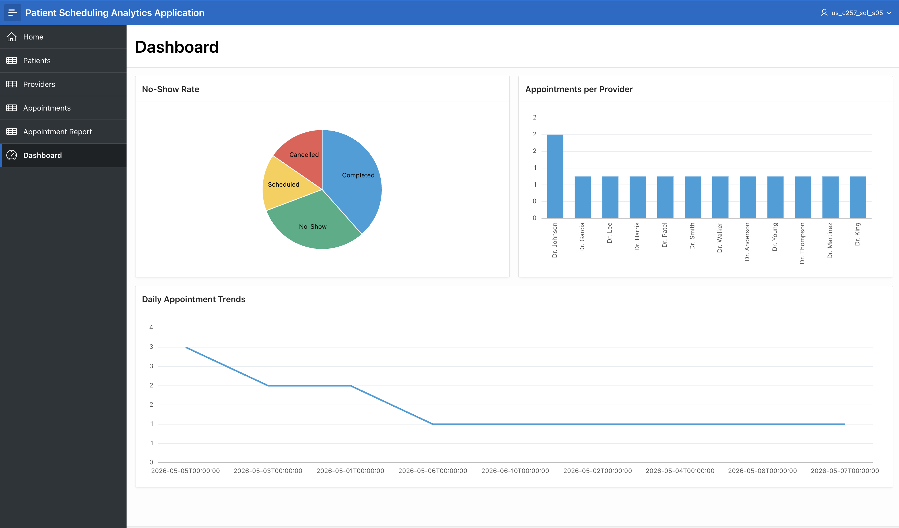
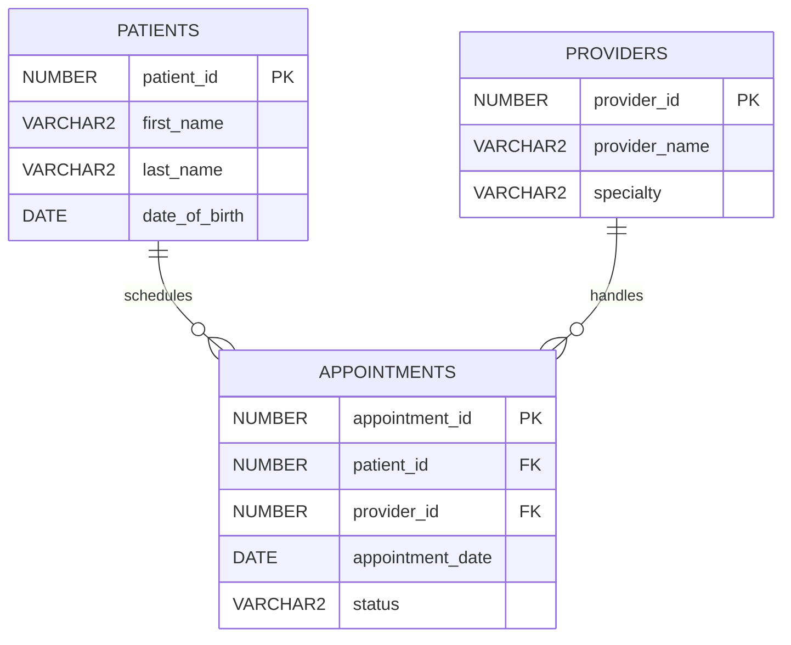
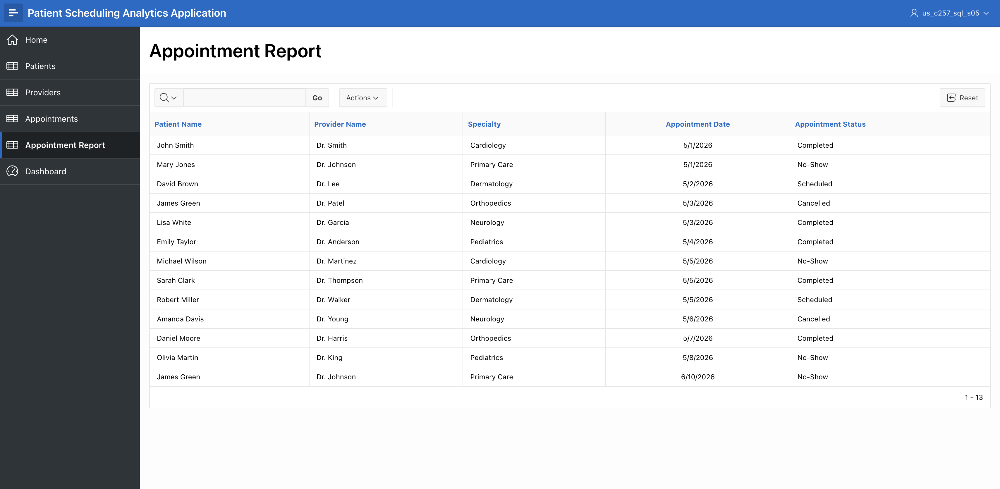
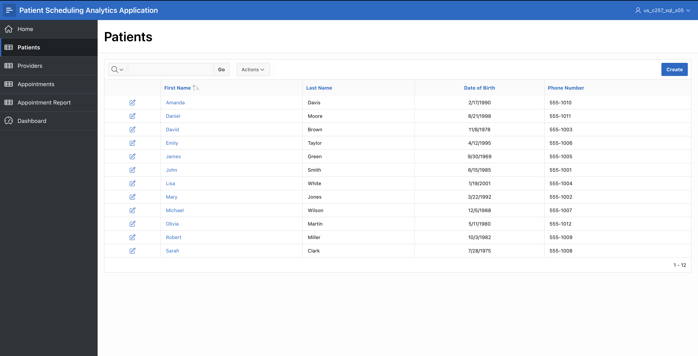
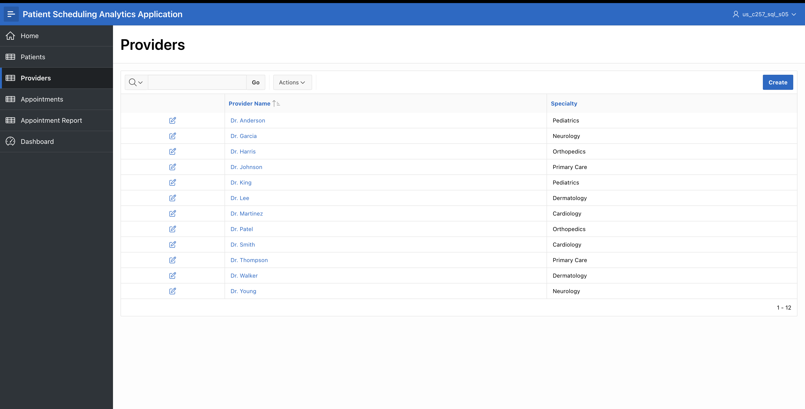
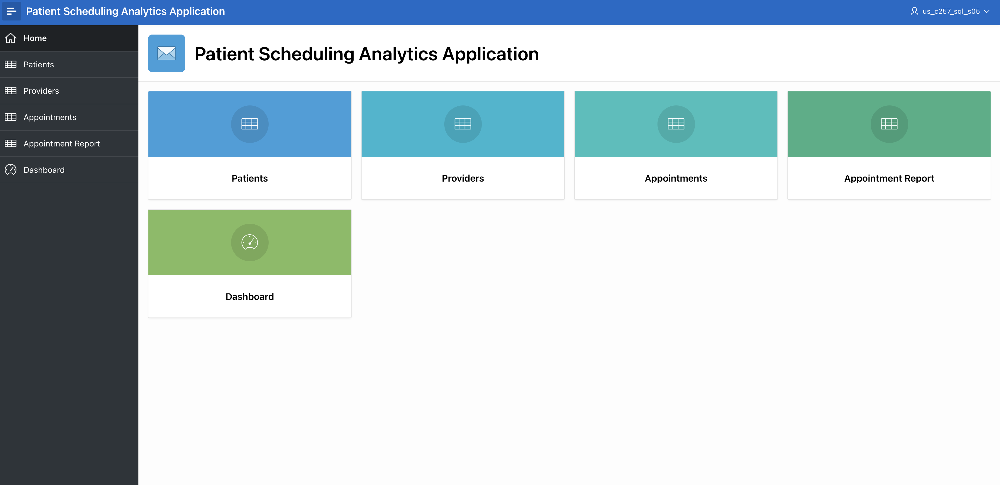

# Patient Scheduling Analytics | Oracle APEX + SQL (Lab 1)

**Healthcare Appointment Analytics · Database Design · Interactive Reports · Business Intelligence**

A course project built with **Oracle SQL** and **Oracle APEX** to organize patient scheduling records and analyze appointment outcomes. The project includes a relational database, interactive reports, and an operational dashboard to help understand **no-show rates, appointments per provider, and daily appointment trends**.

> **Project context:** University coursework / Lab 1. The included records are classroom demonstration data, **not verified clinical records**. This is an educational prototype, not a healthcare production system.



## What I Built

- **Relational database:** Three linked tables—`PATIENTS`, `PROVIDERS`, and `APPOINTMENTS`—using primary keys, foreign keys, and validation constraints.
- **SQL analytics layer:** Four views for appointment reporting, appointment-status distribution, provider utilization, and daily trends.
- **Oracle APEX application:** Interactive pages for patients, providers, and appointment records, plus an appointment report and a dashboard.
- **AI-assisted development and validation:** Reviewed AI-drafted SQL, tested it in Oracle APEX, and documented corrections to unsupported features, report columns, aggregation, and chart configuration.

## Core Database Design



**Analytics views:** `APPOINTMENT_REPORT_V`, `NO_SHOW_RATE_V`, `PROVIDER_UTILIZATION_V`, `DAILY_APPOINTMENT_TRENDS_V`.

## Application Screenshots

| Appointment report | Patient records |
| --- | --- |
|  |  |

| Providers | Home page |
| --- | --- |
|  |  |

See more evidence in [`screenshots/`](screenshots/), including the Object Browser tables, SQL views, and validation queries.

## Repository Contents

```text
├── README.md
├── sql/
│   └── patient_scheduling_schema_and_analytics.sql
├── apex/
│   └── patient_scheduling_application_export.sql
├── screenshots/
│   ├── apex_pages/
│   ├── database_tables/
│   ├── database_views/
│   └── sql_validation/
└── docs/
    ├── ai_validation_report.docx
    └── reflection.docx
```

## How to Reproduce

1. Use an **Oracle APEX workspace** with access to an Oracle database schema and privileges to create tables and views.
2. In **SQL Workshop → SQL Scripts** (or another appropriate Oracle SQL client), run [`sql/patient_scheduling_schema_and_analytics.sql`](sql/patient_scheduling_schema_and_analytics.sql) against an **empty test schema**. The script creates tables, views, and sample records; it is **not** an idempotent migration.
3. In **App Builder → Import**, upload [`apex/patient_scheduling_application_export.sql`](apex/patient_scheduling_application_export.sql), then follow the APEX prompts to install the application in your workspace. The original export comes from an APEX **22.2** environment and has original application ID **9701**; use an available application ID if prompted and verify the parsing schema.
4. Open the imported application and check the Appointment Report and dashboard charts. Environment-specific APEX settings may need to be adjusted.

The **APEX export is the UI/application definition**, while the separate **SQL script is the underlying database setup**. Importing only the APEX export does not guarantee that the tables and data are present.

## AI Validation & Lessons Learned

AI helped draft SQL, but the results required manual review. The validation report documents corrections to an unsupported vector column suggestion, incomplete interactive-report fields, a one-category pie chart, and incorrect **Count vs Sum** chart aggregation.

**Key learning:** Reliable analytics depends on correct data modeling, joins, aggregation, and validation—not merely on generating code quickly.

## Project Scope and Responsible Use

- All screenshots and SQL records are provided as **course demonstration material**. Review screenshots before public reuse.
- This prototype is for scheduling analytics and learning; it is **not a clinical decision-making system**.
- Database objects and APEX exports may need version- and workspace-specific adjustments to run elsewhere.

## Next Stage

The follow-up project adds rule-based no-show risk prediction, validation, and governance:
**[Predictive Healthcare Analytics — Lab 2](https://github.com/Minnie-yu/oracle-apex-predictive-healthcare-analytics)**.
